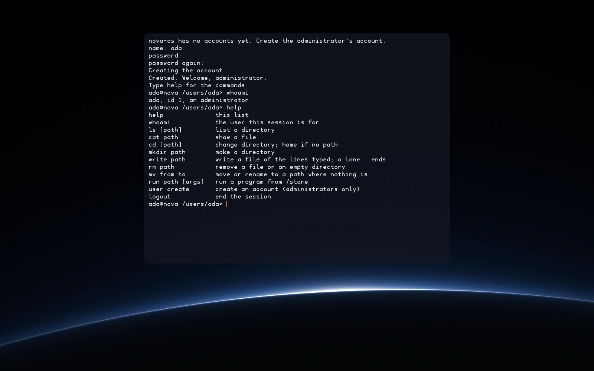

# nova-os

[](https://github.com/Novavero-AI/nova-os/actions/workflows/ci.yml)
[](https://github.com/Novavero-AI/nova-os/actions/workflows/seed.yml)
[](LICENSE)

An operating system with NT's object model on a small kernel core,
drivers in user mode, and disk images that rebuild byte for byte from a
1,623-byte seed.



## What it is

nova-os is an operating system in early development. It boots through
UEFI on x86-64, in a virtual machine for now, and its programming model
is NT's: kernel objects in one namespace, handles with access rights
and a native system-call API, on a small kernel, with drivers, file
systems and services as user-mode processes. It is written in C and
built by TinyCC, and the build gives the same bytes on Linux, on macOS,
and on Windows with a TinyCC built from stage0-pe32's seed.
[DESIGN.md](DESIGN.md) holds its principles, decisions and stages.

## What runs today

**Boot**

- nova-boot, a UEFI application, draws the boot screen, loads the kernel
  and the files beside it from the EFI System Partition, and asks the
  firmware for random seeds
  ([boot-protocol.md](docs/spec/boot-protocol.md)).
- The boot screen fades into Limb, the desktop background, once the
  first process reports that its startup is done.

**Kernel**

- Paging, interrupts, a timer, the ACPI tables, physical memory, and
  threads with a scheduler, on one processor.
- Kernel objects with handles and access rights: processes, jobs,
  sections, channels, ports, interrupts, and the device resources and
  DMA initiators a driver holds ([objects.md](docs/spec/objects.md),
  [ipc.md](docs/spec/ipc.md)).
- The native system-call API, with a lane for 32-bit processes
  ([syscalls.md](docs/spec/syscalls.md)).
- Speculative-execution mitigations chosen for the processor it runs on
  ([speculation.md](docs/spec/speculation.md)).
- A random number generator seeded from the firmware, RDSEED or RDRAND,
  and the timer.
- Self-tests of the page allocator, the random number generator, objects
  and threads on every boot.

**Services and drivers, each a user-mode process**

- The first process starts the rest, and restarts the input driver, the
  console, the accounts service or login when one ends, as its restart
  policy allows ([ipc.md](docs/spec/ipc.md)).
- virtio block and input drivers, for disks and for keyboards, tablets
  and mice, each given its own device's resources and nothing else.
- The store service serves `/store` read-only from the store image,
  checking every block against its hash; store paths are named as Nix
  names them ([storage.md](docs/spec/storage.md)).
- The namespace server holds the one namespace, where `/store`, `/data`
  and `/users` are published.
- The file system service serves `/data` and `/users` from a data disk:
  a copy-on-write pool with a SHA-256 checksum on every block
  ([pool-format.md](docs/spec/pool-format.md)).
- The console draws a panel over the background in its own font, edits
  the line a program reads from the keyboard, and logs what each pointer
  report does ([console.md](docs/spec/console.md)).

**Accounts and the shell**

- On the first boot, login creates the administrator's account; later
  boots log in with a name and a password, which the accounts service
  hashes with Argon2id ([accounts.md](docs/spec/accounts.md)).
- The shell works in the user's home: it lists, shows, writes, moves and
  removes files, runs programs from `/store`, and lets an administrator
  create accounts. `help` lists its commands.

**Text**

- A library that fills outlines and sets lines of text in Inter, from
  nova-os fonts the build converts from Inter's release and keeps in
  `/store` ([font-format.md](docs/spec/font-format.md)).
- The type specimen, a program from `/store`, draws with it in the
  console's place when booted from the specimen's disk.

**Windows programs**

- nova-os's ntdll gives 32-bit Windows programs the routines
  stage0-pe32's bootstrap chain calls. From the test disk the chain runs
  from its hex0 seed to M1, and each link must match the one nova-nix
  builds on Windows ([compat.md](docs/spec/compat.md)).

## Build

[build.sh](build.sh) needs a C compiler as `cc`, `curl`, `tar` and
`unzip`. It fetches TinyCC's source, Inter's release and the test disk's
inputs, and writes every image into the directory it is given:

```sh
./build.sh out
```

[SHA256SUMS](SHA256SUMS) lists the sha256 of every file a build must
reproduce. To check a build:

```sh
(cd out && sha256sum -c ../SHA256SUMS)        # Linux
(cd out && shasum -a 256 -c ../SHA256SUMS)    # macOS
```

After a change meant to change those bytes, `ci/update-hashes.sh OUT`
rebuilds into OUT, a new directory, and rewrites SHA256SUMS; CI only
checks it.

## Run

The system boots in QEMU from `out/disk.img`, with UEFI firmware for
x86-64 and a copy of `out/data.img` as its data disk. On macOS,
Homebrew's `qemu` bundles the firmware:

```sh
code=$(brew --prefix)/share/qemu/edk2-x86_64-code.fd
vars=$(brew --prefix)/share/qemu/edk2-i386-vars.fd
```

On Debian or Ubuntu, with the `qemu-system-x86` and `ovmf` packages
installed:

```sh
code=/usr/share/OVMF/OVMF_CODE_4M.fd
vars=/usr/share/OVMF/OVMF_VARS_4M.fd
```

The first time, copy the data disk and the firmware's variable store,
which each boot writes:

```sh
cp out/data.img out/data-run.img
cp "$vars" out/vars.fd && chmod u+w out/vars.fd
```

Then boot:

```sh
qemu-system-x86_64 -machine q35 -m 256M \
  -drive if=pflash,format=raw,readonly=on,file="$code" \
  -drive if=pflash,format=raw,file=out/vars.fd \
  -drive if=virtio,format=raw,readonly=on,file=out/disk.img \
  -drive if=virtio,format=raw,file=out/data-run.img \
  -net none -device virtio-rng-pci -device virtio-keyboard-pci \
  -device virtio-tablet-pci -serial stdio
```

The kernel and every program log to the terminal through the serial
port. Once the boot screen fades, login runs in the console's panel; on
a fresh data disk it creates the administrator's account and starts the
shell. Booted again, `data-run.img` keeps the account and its files, and
login asks for a name and a password.

The virtio-rng device seeds the kernel's random number generator, which
creating an account needs, since QEMU's default processor has neither
RDRAND nor RDSEED. The virtio tablet gives the console a pointer and,
once its driver runs, keeps QEMU from capturing the mouse.

- `out/specimen.img` in place of `out/disk.img` shows the type specimen
  over Limb; the console runs but draws nothing.
- `out/chain.img` in place of `out/disk.img` runs the bootstrap check
  from the test disk; under emulation it takes minutes.
- With `format=vhdx`, the same drive boots `disk.vhdx` or `chain.vhdx`.
- nova-boot draws in the display's native mode, which
  `-vga none -device VGA,edid=on,xres=2560,yres=1600` sets to
  2560 x 1600. For 3840 x 2160, add `refresh_rate=50000,vgamem_mb=32`
  to the device.

## Documentation

- [docs/spec](docs/spec/README.md) holds nova-os's specifications and
  pins the external specifications they cite.
- [DESIGN.md](DESIGN.md) holds the principles, the decisions made so
  far, the stages and what CI tests.
- The API reference documents the public headers. Doxygen generates it:
  `doxygen` at the repository's root writes it to
  `reference/html/index.html`.
- The specifications, the design and the API reference are also
  published at [novavero.ai/docs/nova-os](https://novavero.ai/docs/nova-os/).

## License

nova-os is licensed under the Apache License 2.0; see [LICENSE](LICENSE).
